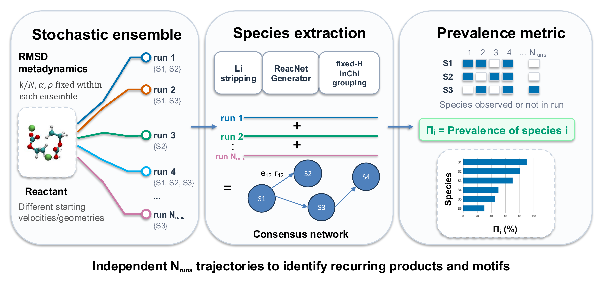

# EnsembleMTD

Ensemble RMSD-driven metadynamics for electrolyte-reduction pathway discovery.
The workflow runs independent GFN2-xTB trajectories and combines their species
and reaction networks using ReacNetGenerator and fixed-H InChI grouping.



## Installation

Requires Python 3.9 or later.

```bash
pip install git+https://github.com/adilpsn/EnsembleMTD.git
```

Install the external programs needed for each stage:

| Stage | Programs |
|---|---|
| Starting geometry and simulations | Open Babel, Packmol, CREST, xTB, GNU sed/awk/bc |
| Analysis | Open Babel, ReacNetGenerator |
| Network rendering | Graphviz |
| Convergence plots | NumPy, Matplotlib |

Open Babel is available through conda or system package managers. The Python
extras install ReacNetGenerator and plotting dependencies:

```bash
pip install "ensemblemtd[reacnet,plots]"
```

## Run an ensemble

Generate a cluster containing one Li ion and two EC molecules:

```bash
./reactor/genmol.sh "[Li+].C1COC(=O)O1.C1COC(=O)O1" liec2
```

Run 20 trajectories of 30 ps each. The positional arguments are the geometry,
charge, bias factor `k/N`, Gaussian width `alpha`, and confinement density.

```bash
./reactor/setup_reactor.sh liec2.xyz 0 0.5 0.6 5 \
    --time 30 --mddump 100 --nrun 20 --walltemp 1000.0 --nm liec2
```

For SLURM, copy `reactor/submit.example.sbatch`, fill in the sections marked
`SITE`, and submit it with `sbatch`. Re-running with a larger `--nrun` adds
trajectories to the existing ensemble.

See [simulation parameters](docs/parameters.md) for settings and options.

## Analyse trajectories

```bash
ensemble-mtd-aggregate --inputs 'liec2k0.5_a0.6run*.trj' --outdir rcng \
    --nohmm --nproc 36 --clean
```

The analysis removes Li, identifies species with ReacNetGenerator, and groups
them by fixed-H InChI. The species table reports the percentage of successful
runs containing each species. Network edges carry event weight (`e`) and
run support (`r`). `--nohmm` disables ReacNetGenerator's temporal filter.

Render the network and calculate species prevalence across ensemble sizes:

```bash
dot -Tpdf rcng/aggregate_reacnet_network.dot -o network.pdf
ensemble-mtd-convergence rcng --production-size 20 \
    --out-csv convergence.csv --plot convergence.pdf
```

See [output files](docs/outputs.md) and
[reproducibility](docs/reproducibility.md) for details.

## Development

```bash
git clone https://github.com/adilpsn/EnsembleMTD.git
cd EnsembleMTD
pip install -e ".[dev,plots]"
pytest -m unit
```

The full test suite requires Open Babel. The reactor smoke test requires CREST
and xTB:

```bash
pytest
bash reactor/smoke_test.sh
```

## Citation

A. Aboobacker, A. Heuer, and D. Diddens. *Ensemble RMSD-Driven Metadynamics
for Electrolyte-Reduction Pathway Discovery*. ChemRxiv, preprint.
[doi:10.26434/chemrxiv.15011301/v1](https://doi.org/10.26434/chemrxiv.15011301/v1).

Citation metadata is provided in [CITATION.cff](CITATION.cff).

## Licence

[MIT](LICENSE). External programs retain their own licences.
